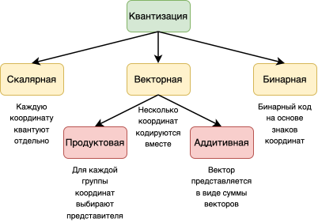

# Часть 1

## Слайд 1 (Введение)

Теперь представим базу данных, которая хранит документы для модели. Документы могут быть очень большими, поэтому, если мы будем подставлять их в модель напрямую, они могут занять значительную часть контекстного окна и ухудшить ответ LLM. Поэтому документы разделяют на блоки и для каждого запроса выбирают из базы данных только $k$ наиболее релевантных ему блоков. Однако, если для каждого блока вычислять его релевантность запросу, поиск может занять много времени. При фиксированной стоимости одной оценки вычисление всех оценок занимает $O(N)$, где $N$ — число блоков в базе данных. Поэтому используют алгоритмы приближённого поиска, которые позволяют значительно уменьшить число блоков, для которых необходимо посчитать релевантность. При этом поиск может пропустить блоки, которые попали бы в точную выдачу.

К тому же, если база данных является векторной, то на плотное хранение самих векторов требуется $N \cdot d \cdot s$ байт, где $N$ — количество векторов, $d$ — размерность вектора, а $s$ — число байт на одну координату. Для решения этой проблемы можно использовать алгоритмы **квантизации**, которые заменяют исходные векторы компактными кодами. Это позволяет уменьшить объём хранения, но приближённое представление векторов может изменить оценки близости и порядок выдачи.

## Слайд 2 (Метрики качества)

Для каждого из $Q$ вопросов рассматриваем первые $k$ результатов поиска. Релевантными считаем фрагменты, которые по разметке содержат ответ на вопрос.

**Hit@k** показывает долю вопросов, для которых в первых $k$ результатах нашёлся хотя бы один релевантный фрагмент. Для вопроса $i$ обозначим попадание как $h_i=1$, а его отсутствие как $h_i=0$.

$$
Hit@k=\frac{1}{Q}\sum_{i=1}^{Q}h_i
$$

**MRR@k** — среднее обратных рангов первого релевантного фрагмента. Если для вопроса $i$ первое попадание стоит на позиции $r_i$, считая с единицы, то $RR_i=1/r_i$. Если в первых $k$ результатах попаданий нет, то $RR_i=0$.

$$
MRR@k=\frac{1}{Q}\sum_{i=1}^{Q}RR_i
$$

Чем ближе первый релевантный фрагмент к началу выдачи, тем больше его вклад в MRR.

## Слайд 3 (Алгоритмы квантизации)

Сначала рассмотрим, как устроена квантизация векторов. Каждому исходному вектору $x$ сопоставляют компактный код, который описывает его приближение $\hat{x}$. Поэтому оценка близости вектора к запросу может измениться, а вместе с ней и порядок результатов поиска.

Алгоритмы различаются тем, как они строят это приближение.

- **Скалярная квантизация (SQ).** Каждую координату квантуют отдельно и сохраняют номер ближайшего уровня.
- **Векторная квантизация.** Несколько координат кодируют совместно.
  - **Продуктовая (PQ и OPQ).** В PQ вектор разбивают на группы координат и для каждой группы выбирают ближайшего представителя. OPQ развивает эту идею и подбирает преобразование координат перед разбиением, чтобы уменьшить ошибку восстановления.
  - **Аддитивная (AQ).** Приближённый вектор получают сложением нескольких полноразмерных представителей, выбранных из разных кодовых книг.
- **Бинарная квантизация (BQ и RaBitQ).** BQ кодирует знак каждой координаты одним битом. RaBitQ строит бинарный код после случайного ортогонального преобразования и использует поправку при оценке близости к запросу.

Простую BQ можно рассматривать как частный случай скалярной квантизации с двумя уровнями. Бинарные методы выделим в отдельную ветку, чтобы проследить переход от кодирования по знаку к RaBitQ.

## Слайд 4 (Скалярная квантизация, SQ)

Рассмотрим одну координату вектора со значением $x$. Если на её код выделено $b$ бит, можно задать $L=2^b$ уровней. В равномерной SQ выбираем диапазон $[l,u]$ и размещаем уровни с одинаковым шагом $\Delta$. Значение уровня с номером $j$ обозначим через $c_j$.

$$
\Delta=\frac{u-l}{L-1}
$$

$$
c_j=l+j\Delta, j=0,...,L-1
$$

Код $q(x)$ — номер уровня с наименьшей квадратичной ошибкой.

$$
q(x)\in\argmin_{j=0,...,L-1}(x-c_j)^2
$$

Подставим $c_j$ в выражение для ошибки и получим

$$
(x-c_j)^2=\Delta^2(\frac{x-l}{\Delta}-j)^2
$$

Множитель $\Delta^2$ одинаков для всех уровней. Поэтому округляем $(x-l)/\Delta$ до ближайшего целого и ограничиваем результат допустимым диапазоном номеров.

$$
q(x)=clip(round(\frac{x-l}{\Delta}),0,L-1)
$$

В базе сохраняем **номер уровня** $q(x)$. При восстановлении получаем **значение этого уровня** $\hat{x}=c_{q(x)}=l+q(x)\Delta$.

Для целого вектора повторяем эти шаги по каждой координате. Квадрат ошибки восстановления вектора равен сумме квадратов ошибок координат, поэтому ближайший уровень можно выбирать для каждой координаты независимо.

Для любого $x\in[l,u]$ ошибка восстановления по модулю не превышает половины шага сетки.

$$
|x-\hat{x}|\leq\frac{\Delta}{2}
$$

$$
(x-\hat{x})^2\leq\frac{\Delta^2}{4}
$$

За пределами диапазона выбираем крайний уровень, и ошибка по модулю равна расстоянию до ближайшей границы диапазона.

Если все $d$ координат вектора лежат в этом диапазоне и квантуются с одним шагом $\Delta$, получаем

$$
\|x-\hat{x}\|_2^2=\sum_{i=1}^{d}(x_i-\hat{x}_i)^2\leq\frac{d\Delta^2}{4}
$$

$$
\|x-\hat{x}\|_2\leq\frac{\sqrt{d}\Delta}{2}
$$

## Слайд 6 (Продуктовая квантизация, PQ)

В скалярной квантизации мы выбирали уровень для каждой координаты отдельно. В PQ разбиваем координаты на $m$ непересекающихся групп. Через $x_i^{(r)}$ обозначим часть вектора $x_i$, которая относится к группе $r$.

Для каждой группы строим свою **кодовую книгу** — набор из $K$ векторов той же размерности, что и группа. Пусть $c_j^{(r)}$ — представитель этой группы с номером $j$. Для группы $r$ вектора $x_i$ выбираем ближайшего представителя и обозначаем его номер через $z_{ir}$.

$$
z_{ir}\in\arg\min_j\|x_i^{(r)}-c_j^{(r)}\|_2^2
$$

При восстановлении собираем приближённый вектор из выбранных представителей в порядке групп.

$$
\hat{x}_i=(c_{z_{i1}}^{(1)},...,c_{z_{im}}^{(m)})
$$

Кодовые книги подбираем так, чтобы уменьшить суммарную квадратичную ошибку восстановления на $n$ обучающих векторах. Поскольку группы координат не пересекаются, общую ошибку можно разложить по группам.

$$
J=\sum_{i=1}^{n}\|x_i-\hat{x}_i\|_2^2
=\sum_{r=1}^{m}\sum_{i=1}^{n}\|x_i^{(r)}-c_{z_{ir}}^{(r)}\|_2^2
$$

Внутренняя сумма зависит только от представителей и их номеров в одной группе. Поэтому для каждой группы отдельно запускаем **k-means** и используем центры кластеров как представителей.

В базе храним $m$ номеров на вектор, а кодовые книги общие. Название «продуктовая» связано с тем, что представителей разных групп можно комбинировать независимо. Из $m$ книг по $K$ представителей получается $K^m$ возможных кодов.

## Слайд 8 (Модификация: OPQ)

В PQ мы заранее разбиваем координаты на группы и обучаем для каждой свою кодовую книгу. Ошибка восстановления зависит от этого разбиения. Если связанные координаты оказались в разных группах, их приходится кодировать независимо, и часть этой связи теряется при приближении.

Идея **OPQ (Optimized Product Quantization)** — подобрать более удобную систему координат перед разбиением. Пусть $X$ — матрица исходных векторов, записанных по строкам, а $R$ — ортогональная матрица. Сначала преобразуем векторы и получаем $XR$, затем применяем к ним обычную PQ. Само преобразование сохраняет расстояния между векторами, но меняет координаты, которые попадают в каждую группу.

Обозначим через $Y$ приближённые векторы, восстановленные после PQ в новой системе координат. Тогда обучаем матрицу $R$ и кодовые книги так, чтобы уменьшить ошибку

$$
J=\|XR-Y\|_F^2
$$

Это сумма квадратов ошибок по всем векторам и координатам. Обучение чередует два шага. Сначала фиксируем $R$ и обучаем PQ на $XR$. Затем фиксируем полученные приближения $Y$ и с помощью SVD подбираем $R$, при которой $XR$ ближе к $Y$.

Чтобы вернуть приближённые векторы в исходную систему координат, умножаем $Y$ на $R^T$. Код вектора по-прежнему состоит из $m$ номеров представителей. Матрицу $R$ сохраняем один раз для всей базы.

## Слайд 10 (Аддитивная квантизация, AQ)

В PQ мы собирали приближённый вектор из представителей отдельных групп координат. В AQ каждая кодовая книга содержит **полноразмерные векторы**. Из каждой книги выбираем по одному представителю, а затем складываем их.

Пусть $M$ — число кодовых книг, $c_{m,j}$ — представитель с номером $j$ из книги $m$, а $z_{im}$ — номер представителя, выбранного для вектора $x_i$ из этой книги. Тогда восстановленный вектор имеет вид

$$
\hat{x}_i=\sum_{m=1}^{M}c_{m,z_{im}}
$$

Кодовые книги $C$ и номера представителей $Z$ подбираем так, чтобы уменьшить суммарную квадратичную ошибку на $n$ обучающих векторах.

$$
J(C,Z)=\sum_{i=1}^{n}\|x_i-\hat{x}_i\|_2^2
$$

Чтобы понять, почему книги связаны, рассмотрим один исходный вектор $x$. Обозначим через $c_m$ выбранного для него представителя из книги $m$ и раскроем квадрат ошибки восстановления.

$$
\|x-\sum_m c_m\|_2^2
=\|x\|_2^2-2\sum_m x^T c_m+\sum_m\|c_m\|_2^2+2\sum_{m<j}c_m^T c_j
$$

Последнее слагаемое содержит скалярные произведения представителей из разных книг. Поэтому ошибка при выборе $c_m$ зависит от того, какие представители выбраны из остальных книг.

Начальное приближение можно построить последовательно. Первую книгу обучаем на исходных векторах, а каждую следующую — на остатках после вычитания уже выбранных представителей. Затем при фиксированных книгах уточняем номера представителей, а при фиксированных номерах обновляем сами книги.

**Уточнение номеров представителей.** Для вектора $x_i$ фиксируем выбор во всех книгах, кроме книги $m$. Вычитаем из $x_i$ вклад этих книг и получаем $t_{im}$ — вектор, который должна приблизить книга $m$. Новый номер выбираем по наименьшему расстоянию до $t_{im}$.

$$
t_{im}=x_i-\sum_{s\ne m}c_{s,z_{is}}
$$

$$
z_{im}\in\arg\min_j\|t_{im}-c_{m,j}\|_2^2
$$

Затем так же уточняем выбор в следующей книге с учётом уже обновлённых номеров.

Для каждого вектора храним $M$ номеров. При восстановлении по этим номерам находим соответствующие векторы в общих кодовых книгах и складываем их.

## Слайд 12 (Бинарная квантизация, BQ)

Пусть $x$ — исходный вектор размерности $d$, а $c$ — его приближение. Каждая координата $c_i$ равна либо $-1$, либо $+1$. Ищем приближение с минимальной ошибкой восстановления.

$$
\min_{c\in\{-1,+1\}^d}\|x-c\|_2^2
$$

Раскроем квадрат нормы. Поскольку $\|c\|_2^2=d$ для любого допустимого $c$, получаем

$$
\|x-c\|_2^2=\|x\|_2^2+d-2x^T c
$$

Первые два слагаемых фиксированы, поэтому минимизация ошибки сводится к максимизации $x^T c=\sum_i x_i c_i$. Каждое произведение $x_i c_i$ не превышает $|x_i|$. Эта граница достигается, когда знаки $x_i$ и $c_i$ совпадают. При $x_i=0$ оба значения равноценны, поэтому по соглашению выбираем $+1$.

Будем считать, что бит $b_i=1$, если $x_i\geq 0$, и $b_i=0$, если $x_i<0$. Тогда $c_i=2b_i-1$, а квадрат ошибки восстановления равен

$$
\|x-c\|_2^2=\sum_{i=1}^{d}(|x_i|-1)^2
$$

## Слайд 14 (BQ: интерпретация)

Пусть векторы $x$ и $q$ единичные, то есть $\|x\|_2=\|q\|_2=1$.

На рисунке $x$ — исходный вектор фрагмента, $c$ — его знаковое приближение, а $q$ — вектор запроса. В двух измерениях допустимые знаковые векторы образуют четыре вершины квадрата.

У всех знаковых векторов $v$ одна длина, $\sqrt{d}$. Поэтому при фиксированном $x$ знаменатель в формуле косинуса одинаков для всех $v$.

$$
\cos(x,v)=\frac{x^T v}{\|x\|_2\sqrt{d}}=\frac{x^T v}{\sqrt{d}}.
$$

Чтобы получить наибольший косинус, достаточно максимизировать $x^T v$. Как мы видели на слайде с алгоритмом BQ, для этого выбираем знак каждой координаты $x$. Тот же выбор минимизирует косинусное расстояние.

$$
c=\mathrm{sign}(x)\in\arg\min_{v\in\{-1,+1\}^d}(1-\cos(x,v)).
$$

Обозначим угол между $x$ и $c$ через $\theta$.

Чтобы сравнить косинусные оценки до и после квантизации, нормируем знаковый вектор. Получаем $\tilde c=c/\sqrt{d}$. Его длина равна $1$, а направление совпадает с направлением $c$. Угол между $x$ и $\tilde c$ по-прежнему равен $\theta$.

Нормируем вектор $c$ и сделаем проекцию векторов $c$ и $x$ на вектор $q$, Получим вектора $\hat{c}$ и $\hat{x}$. Так как векторы $c$ и $x$ единичные, то длины проекций равны модулю косинуса между векторов $q$ и векторами $c$ и $x$. Тогда:

$$
||\hat{x} - \hat{c}||_2 = |\cos(q,x)-\cos(q,c)|
$$

При этом, вектор $\hat{x} - \hat{c}$ - проекция вектора $x - c$, а его длина:

$$
||x - c||_2 = \sqrt{||x||_2 + ||c||_2 - 2cos\theta} = \sqrt{2(1-cos\theta)} 
$$ 
Тогда получаем, что:
$$
|\cos(q,x)-\cos(q,c)| \leq \sqrt{2(1-cos\theta)} 
$$

## Слайд 15 (Модификация: RaBitQ)

Пусть $x$ и $q$ — единичные векторы фрагмента и запроса. В BQ мы брали знаки исходных координат. В RaBitQ сначала поворачиваем $x$ случайной ортогональной матрицей $R$, общей для всей базы. Сохраняем знаки $s$ и обозначаем через $c$ единичное знаковое приближение в исходных координатах.

$$
s=\mathrm{sign}(xR),\qquad c=\frac{sR^T}{\sqrt d}.
$$

Разложим $c$ на составляющую вдоль $x$ и перпендикулярную составляющую $e$. Коэффициент $\alpha$ — проекция $c$ на единичный вектор $x$.

$$
c=\alpha x+e,\qquad \alpha=\langle c,x\rangle,\qquad e\perp x.
$$

Если взять скалярное произведение $c$ с запросом $q$, исходная оценка $\langle x,q\rangle$ войдёт в результат с множителем $\alpha$.

$$
\langle c,q\rangle=\alpha\langle x,q\rangle+\langle e,q\rangle.
$$

Делим результат на $\alpha$, чтобы компенсировать этот множитель. Для вычисления сохраняем для каждого вектора его знаки $s$ и коэффициент $\alpha$, а при поиске поворачиваем запрос той же матрицей $R$.

$$
\hat S(x,q)=\frac{\langle c,q\rangle}{\alpha}
=\frac{\langle s,qR\rangle}{\sqrt d\,\alpha}.
$$

Для единичных $x$ и $q$ величина $\hat S(x,q)$ приближает исходную косинусную близость $\cos(x,q)$. Поэтому при поиске по сжатым кодам ранжируем фрагменты по убыванию $\hat S$ вместо прямого расчёта косинусного расстояния. В терминах расстояния это соответствует выбору наименьших значений $1-\hat S$.

## Слайд 17 (RaBitQ: граница ошибки оценки)

Зафиксируем единичные векторы фрагмента $x$ и запроса $q$. Точное сходство исходных векторов равно $S(x,q)=\langle x,q\rangle$. По сжатому коду RaBitQ вычисляет приближение $\hat S(x,q)$.

На предыдущем теоретическом слайде мы разложили знаковое приближение как $c=\alpha x+e$, где $e\perp x$. Обозначим через $\varphi$ угол между ненулевым остатком $e$ и запросом. Так как $q$ — единичный вектор, получаем

$$
\hat S(x,q)-S(x,q)
=\frac{\langle e,q\rangle}{\alpha}
=\frac{\|e\|_2}{\alpha}\cos\varphi.
$$

Длину остатка находим по теореме Пифагора. Длина $c$ равна $1$, а длина его составляющей вдоль $x$ равна $\alpha$, поэтому

$$
\|e\|_2=\sqrt{1-\alpha^2}.
$$

Оставим $x$ и $q$ фиксированными и представим, что заново выбираем случайный поворот $R$. Тогда меняется знаковое приближение $c$ и может измениться направление остатка $e$. При фиксированном $\alpha$ остаток равномерно направлен в $(d-1)$-мерном пространстве, перпендикулярном $x$. Характерный масштаб проекции случайного единичного направления на фиксированную ось там равен $1/\sqrt{d-1}$.

Теорема RaBitQ даёт вероятностную границу $\varepsilon/\sqrt{d-1}$ для $|\cos\varphi|$. Подставляем её в выражение для ошибки и получаем

$$
|\hat S(x,q)-S(x,q)|\leq\eta_S,\qquad
\eta_S=\frac{\sqrt{1-\alpha^2}}{\alpha}\frac{\varepsilon}{\sqrt{d-1}}.
$$

## Слайд 18 (Алгоритмы поиска)

Теперь представим, что документы уже разделены на фрагменты и записаны в базу. Когда приходит вопрос, нам нужно выбрать $k$ фрагментов, которые передадим модели. Можно посчитать релевантность каждого фрагмента и взять $k$ лучших. Но чем больше база, тем больше таких сравнений приходится делать для каждого запроса. Поэтому заранее строят индекс, который помогает при поиске сосредоточиться на перспективных фрагментах.

Методы поиска можно разделить по тому, **на чём основана оценка релевантности**.

- **Векторные методы** сравнивают эмбеддинги запроса и фрагментов. В точном поиске сравнение выполняется со всей базой. В приближённом поиске индекс помогает выбрать часть векторов для проверки. Мы рассматриваем два семейства таких индексов.
  - **Кластерные.** Векторы объединяют в группы, и поиск ведётся по выбранным группам. Сюда относятся IVF и IVF + RaBitQ.
  - **Графовые.** Векторы связывают с соседями, и поиск идёт по этим связям. Здесь мы рассматриваем HNSW.
- **Лексические методы** оценивают релевантность по словам, которые встречаются в запросе и фрагменте. В этой группе рассмотрим BM25.
- **Гибридные методы** учитывают и сходство эмбеддингов, и совпадения слов при составлении общей выдачи.

## Слайд 19 (IVF)

Пусть в базе хранится $N$ векторов. Обозначим через $L$ общее число кластеров, через $P$ — число кластеров, которые просматриваем для одного запроса, а через $c_j$ — центр кластера $j$. Центры обучаем с помощью $k$-means, затем каждый вектор базы относим к ближайшему центру.

Когда приходит запрос $q$, выбираем $P$ центров с наименьшими значениями $\|q-c_j\|_2^2$. Среди векторов $x_i$ из этих кластеров выбираем $k$ лучших по косинусной близости.

Если $N$ векторов распределены по кластерам примерно поровну, в одном списке около $N/L$ векторов. Тогда после сравнения с $L$ центроидами остаётся проверить примерно $PN/L$ кандидатов. Это и даёт выигрыш, когда просматриваем лишь небольшую часть кластеров.

### IVF + RaBitQ

В обычном IVF сначала выбираем $P$ ближайших кластеров, а затем считаем точное сходство с каждым вектором из этих кластеров. Если в них много векторов, эта часть поиска всё ещё может быть дорогой. Добавим RaBitQ, чтобы по сжатым кодам решить, для каких кандидатов нужен точный расчёт.

**Что кодируем.** Пусть $x_i$ принадлежит кластеру с центром $c_j$. Для каждого вектора кодируем его остаток относительно центра.

$$
r_i=x_i-c_j.
$$

Остаток показывает, чем вектор отличается от центра своего кластера. К $r_i$ применяем RaBitQ. Кодируем его направление и учитываем длину при вычислении оценки. Исходный вектор $x_i$ храним для точного пересчёта.

**Как получаем оценку.** Поскольку $x_i=c_j+r_i$, скалярное произведение с запросом раскладывается на два слагаемых.

$$
S(x_i,q)=\langle c_j,q\rangle+\langle r_i,q\rangle.
$$

Первое слагаемое одинаково для всех векторов кластера и уже известно после сравнения запроса с центрами. Второе приближаем по коду остатка.

$$
\hat S(x_i,q)=\langle c_j,q\rangle+\hat S(r_i,q).
$$

Вклад центра вычислен точно, поэтому граница ошибки $\eta_{S,i}$ для оценки остатка подходит и для оценки всего вектора. Прибавляем её к оценке и получаем верхнюю границу сходства.

$$
U_i=\hat S(x_i,q)+\eta_{S,i}.
$$

**Кого пересчитываем точно.** Рассматриваем кандидатов по убыванию $U_i$ и поддерживаем список из $k$ лучших по точным оценкам сходства. Когда список заполнен, обозначим наименьшую точную оценку в нём через $\tau$.

Если $U_i<\tau$, то при выполнении границы ошибки даже верхняя граница сходства кандидата ниже порога для попадания в текущий top-$k$. У всех ещё не рассмотренных кандидатов границы не больше $U_i$, поскольку мы отсортировали их по убыванию. Поэтому на этом шаге можно остановиться. До него считаем точное сходство по исходным векторам и обновляем top-$k$.

## Слайд 21 (HNSW)

Каждому вектору базы $x_v$ соответствует вершина $v$. На нижнем уровне графа находятся все вершины, а на верхних — всё меньшие их подмножества. Для единичных эмбеддингов сходство вершины с запросом $q$ равно $S_q(v)=\langle q,x_v\rangle$.

**Построение графа.** При добавлении вершины $u$ случайно выбираем её максимальный уровень.

$$
\ell(u)=\lfloor -m_L\ln U\rfloor,\qquad U\sim\mathrm{Uniform}(0,1).
$$

Параметр $m_L$ задаёт, как часто вершины попадают на верхние уровни. Вершину $u$ добавляем на уровни от $0$ до $\ell(u)$. Чтобы создать рёбра, ищем соседей для $x_u$ в уже построенной части графа. На каждом уровне, куда добавляем вершину, сохраняем до $B_c$ лучших кандидатов и выбираем из них до $M$ соседей для связи.

**Поиск на верхних уровнях.** Начинаем с входной вершины на верхнем уровне. Пусть $v$ — текущая вершина, а $\mathcal N_\ell(v)$ — её соседи на уровне $\ell$. Сравниваем текущую вершину с её соседями.

$$
v'=\arg\max_{w\in\{v\}\cup\mathcal N_\ell(v)} S_q(w).
$$

Если $S_q(v')>S_q(v)$, переходим в $v'$ и проверяем уже её соседей. Когда улучшения нет, спускаемся на следующий уровень с той же вершины.

**Поиск на нижнем уровне.** Ведём очередь $C$ вершин, чьих соседей ещё можно проверить, и список $W$ из максимум $B_s$ лучших уже найденных вершин. На каждом шаге берём из очереди вершину с наибольшим сходством и сравниваем её с худшей в списке лучших.

$$
v_*=\arg\max_{v\in C}S_q(v),\qquad
\tau=\min_{v\in W}S_q(v).
$$

Если $|W|=B_s$ и $S_q(v_*)<\tau$, останавливаемся. Иначе проверяем ещё не просмотренных соседей $v_*$. Тех, кто попадает в список лучших, также добавляем в очередь для продолжения поиска. В конце возвращаем $k$ лучших вершин из $W$.

## Слайд 23 (BM25 и гибридный поиск)

**BM25** оценивает фрагмент $D$ по словам из запроса $q$. Пусть $f_{t,D}$ — сколько раз слово $t$ встречается во фрагменте, $|D|$ — длина фрагмента в словах, а $\bar L$ — средняя длина фрагмента в базе.

Редкие слова получают больший вес. Если в базе $N$ фрагментов и слово $t$ встречается в $n_t$ из них, его вес равен

$$
\mathrm{IDF}(t)=\ln\left(1+\frac{N-n_t+0.5}{n_t+0.5}\right).
$$

Оценка фрагмента складывается из вкладов различных слов запроса.

$$
s_{\mathrm{BM25}}(D,q)=
\sum_{t\in q}\mathrm{IDF}(t)
\frac{f_{t,D}(k_1+1)}
{f_{t,D}+k_1(1-b+b|D|/\bar L)}.
$$

Параметр $k_1$ управляет тем, как быстро уменьшается вклад каждого следующего повторения слова. Параметр $b$ задаёт, насколько сильно учитываем длину фрагмента.

**BM25-hybrid.** Получаем два списка кандидатов — от BM25 и от векторного поиска. В каждом списке отдельно приводим оценки к диапазону $[0,1]$, затем объединяем кандидатов и считаем взвешенную сумму.

$$
\tilde s=\frac{s-s_{\min}}{s_{\max}-s_{\min}},
\qquad
s_{\mathrm{hybrid}}=
\alpha\tilde s_{\mathrm{vec}}+(1-\alpha)\tilde s_{\mathrm{BM25}}.
$$

Здесь $\alpha\in[0,1]$ — вес векторной оценки. Если фрагмент есть только в одном списке, он получает вклад только от этого метода. В итоговый top-$k$ берём фрагменты с наибольшими значениями $s_{\mathrm{hybrid}}$.
